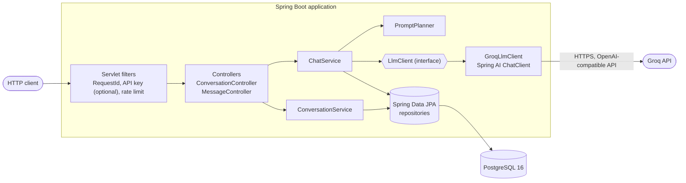
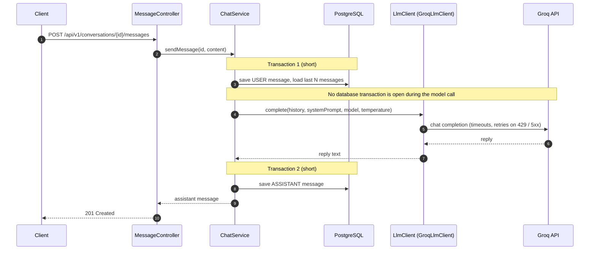

# Spring AI Chat Engine

[](https://github.com/agentworkshq/spring-ai-chat-engine/actions/workflows/ci.yml)

A backend-only conversational AI REST API. It stores conversations and messages in PostgreSQL,
sends the conversation to a language model hosted on [Groq](https://groq.com), and returns the reply
either as one JSON response or streamed as server-sent events.

Groq is reached through **Spring AI's OpenAI-compatible starter**
(`spring-ai-starter-model-openai`) pointed at Groq's OpenAI-compatible endpoint, so no OpenAI
account is involved and the provider sits behind a small `LlmClient` interface.

## Contents

- [Features](#features)
- [Architecture](#architecture)
- [Tech stack](#tech-stack)
- [Quick start with Docker Compose](#quick-start-with-docker-compose)
- [Configuration](#configuration)
- [API](#api)
- [Project structure](#project-structure)
- [Testing](#testing)
- [Operational notes and limitations](#operational-notes-and-limitations)
- [Roadmap](#roadmap)

## Features

- **Conversations and messages**: create, list, read, rename and delete conversations; full message
  history is stored in PostgreSQL (schema managed by Flyway).
- **Replies from Groq**: one JSON response, or a **server-sent event stream** that delivers the
  reply while it is generated.
- **Per-conversation overrides**: each conversation can carry its own system prompt, model and
  temperature; otherwise the server defaults apply.
- **Prompt control**: the system prompt is always sent first, and only the most recent messages
  (a sliding window, 20 by default) are sent as history.
- **No transaction held during the model call**: the user message and history are read in one short
  transaction, the model is called with no transaction open, and the reply is saved in a second
  short one.
- **Resilient provider calls**: configurable connect/read timeouts, and retries with exponential
  backoff for transient failures only (408, 409, 429, 5xx, timeouts, connection errors),
  honouring `Retry-After`.
- **Predictable errors**: every error has the same five-field JSON body. Provider failures map to
  `429`, `503` or `502` with generic messages that never contain keys or raw provider output.
- **Protection**: per-IP rate limiting on the two message endpoints (Bucket4j), and optional API key
  authentication through an `X-API-Key` header. Neither needs Spring Security.
- **Observability**: an `X-Request-Id` header (accepted or generated) that is echoed in the response
  and added to every log line; health endpoint via Actuator.
- **Interactive docs**: OpenAPI 3.1 and Swagger UI via springdoc-openapi.
- **Ready to ship**: layered, non-root Docker image with a health check, Docker Compose stack and a
  GitHub Actions pipeline.

## Architecture



The flow of one message (`POST /api/v1/conversations/{id}/messages`):



The streaming endpoint follows the same steps, except the reply is emitted chunk by chunk and the
assistant message is saved only when the stream completes.

## Tech stack

| Area | Technology |
| --- | --- |
| Language / runtime | Java 21 |
| Framework | Spring Boot 4.1.2 (Spring MVC, Spring Framework 7, Jackson 3) |
| LLM integration | Spring AI 2.0.1, `spring-ai-starter-model-openai` against Groq's OpenAI-compatible API |
| Persistence | PostgreSQL 16, Spring Data JPA (Hibernate), Flyway |
| Rate limiting | Bucket4j 8.22.0 (`bucket4j_jdk17-core`) |
| API docs | springdoc-openapi 3.2.0 (OpenAPI 3.1, Swagger UI) |
| Build | Maven (wrapper, Maven 3.10.0) |
| Testing | JUnit 5, Mockito, AssertJ, Spring MockMvc, Testcontainers (PostgreSQL) |
| Packaging / CI | Docker (layered image), Docker Compose, GitHub Actions |

## Quick start with Docker Compose

**Prerequisites:** Docker with Compose v2, and a Groq API key from the
[Groq console](https://console.groq.com).

```bash
# 1. Create your environment file and put your Groq key in it
cp .env.example .env          # Windows PowerShell: Copy-Item .env.example .env
#    edit .env and set GROQ_API_KEY=...

# 2. Build and start PostgreSQL and the application
docker compose up --build
```

The first build downloads Maven and all dependencies, so it takes a few minutes; later builds reuse
Docker's layer cache. When the `app` service reports `healthy` (see `docker compose ps`), the API is
ready on port 8080:

```bash
curl http://localhost:8080/actuator/health
# {"groups":["liveness","readiness"],"status":"UP"}
```

Then open **Swagger UI** at <http://localhost:8080/swagger-ui.html> (the raw OpenAPI document is at
`/v3/api-docs`), or jump to the [curl examples](#api).

To stop: `docker compose down` (add `-v` to also delete the database volume).

`.env` is listed in `.gitignore`; never commit it.

### Running without Docker for the app

```bash
docker compose up -d postgres            # just the database, on localhost:5432
export GROQ_API_KEY=...                  # PowerShell: $env:GROQ_API_KEY = "..."
./mvnw spring-boot:run                   # Windows: mvnw.cmd spring-boot:run
```

### Troubleshooting

- **Groq answers `404` / the API returns `502`**: check the model name. Models come and go; list
  the ones your key can use with
  `curl https://api.groq.com/openai/v1/models -H "Authorization: Bearer $GROQ_API_KEY"` and set
  `GROQ_MODEL`. The base URL must end in `/v1` (Spring AI 2.0 appends only `/chat/completions`).
- **The app cannot log in to PostgreSQL**: Compose gives shell environment variables priority over
  `.env`. If `DB_USER` or `DB_PASSWORD` are exported in your shell with other values, they override
  the defaults.
- **The app does not start and mentions `GROQ_API_KEY`**: it is required and has no default.

## Configuration

All settings live in `src/main/resources/application.yml`; most can be set with environment
variables. Docker Compose forwards only the variables marked in the last column. To set any other
one in Compose, add it under `app.environment` in `docker-compose.yml`.

| Variable | Default | Description | In Compose |
| --- | --- | --- | :---: |
| `GROQ_API_KEY` | none, **required** | Groq API key. Passed to Spring AI as `spring.ai.openai.api-key`. | yes |
| `GROQ_MODEL` | `openai/gpt-oss-120b` | Default model, used when a conversation has no `model` of its own. | yes |
| `DB_NAME` | `chatengine` | PostgreSQL database name (also used to create the Compose database). | yes |
| `DB_USER` | `chat` | PostgreSQL user. | yes |
| `DB_PASSWORD` | `chat` | PostgreSQL password. Change it outside local development. | yes |
| `SPRING_DATASOURCE_URL` | `jdbc:postgresql://localhost:5432/${DB_NAME}` | Full JDBC URL; Compose points it at the `postgres` service. | yes |
| `SPRING_DATASOURCE_USERNAME` / `SPRING_DATASOURCE_PASSWORD` | from `DB_USER` / `DB_PASSWORD` | Override the credentials directly. | yes |
| `API_KEY_ENABLED` | `false` | When `true`, every request except `/actuator/health` and the OpenAPI docs must send `X-API-Key`. | yes |
| `API_KEY` | empty | The expected key. **Required when `API_KEY_ENABLED=true`**; startup fails without it. | yes |
| `RATE_LIMIT_RPM` | `20` | Requests per minute per client IP on the two message endpoints (also the burst size). | yes |
| `RATE_LIMIT_ENABLED` | `true` | Turn the rate limit off. | no |
| `LLM_CONNECT_TIMEOUT` | `5s` | Timeout for connecting to Groq. | no |
| `LLM_READ_TIMEOUT` | `60s` | Maximum silence while waiting for Groq, including between streamed chunks. | no |
| `LLM_MAX_ATTEMPTS` | `3` | Total attempts per Groq call, first included. `1` disables retries. | no |
| `CHAT_HISTORYWINDOW` | `20` | How many of the most recent messages are sent as history. Must be at least 1. | no |
| `CHAT_MAXINPUTCHARS` | `8000` | Longest accepted user message, in characters. | no |
| `CHAT_SYSTEMPROMPT` | a concise, helpful assistant prompt | Default system prompt, used when a conversation has none. | no |
| `JAVA_OPTS` | `-XX:MaxRAMPercentage=75 -XX:+ExitOnOutOfMemoryError` | JVM flags in the Docker image. Setting it replaces these defaults. | no |

`CHAT_HISTORYWINDOW` and the other `CHAT_*` names are Spring Boot's standard environment form of
`chat.history-window` and so on (`CHAT_HISTORY_WINDOW` works too).

When the app runs behind a reverse proxy, also set `SERVER_FORWARD_HEADERS_STRATEGY=native` so the
rate limiter sees the real client IP instead of the proxy's.

## API

Base path: `/api/v1/conversations`. Requests and responses are JSON, except the streaming endpoint.
All examples below were run against the Compose stack; IDs and timestamps will differ for you.
If you enabled API key authentication, add `-H "X-API-Key: $API_KEY"` to every call.

| Method | Path | Success | Purpose |
| --- | --- | --- | --- |
| `POST` | `/api/v1/conversations` | `201` | Create a conversation |
| `GET` | `/api/v1/conversations` | `200` | List conversations, newest first |
| `GET` | `/api/v1/conversations/{id}` | `200` | Get a conversation with all its messages |
| `PATCH` | `/api/v1/conversations/{id}` | `200` | Update title, system prompt, model, temperature |
| `DELETE` | `/api/v1/conversations/{id}` | `204` | Delete a conversation and its messages |
| `POST` | `/api/v1/conversations/{id}/messages` | `201` | Send a message, get the reply |
| `POST` | `/api/v1/conversations/{id}/messages/stream` | `200` | Send a message, stream the reply (SSE) |

Interactive documentation with every response code and example is in Swagger UI
(`/swagger-ui.html`).

### Create a conversation

Only `title` is required (1 to 200 characters). `systemPrompt`, `model` (up to 255 characters) and
`temperature` (0.0 to 2.0) are optional overrides for this conversation.

```bash
curl -i -X POST http://localhost:8080/api/v1/conversations \
  -H 'Content-Type: application/json' \
  -d '{"title":"Trip planning","systemPrompt":"You are a concise travel assistant.","temperature":0.4}'
```

```http
HTTP/1.1 201
Location: /api/v1/conversations/475fbf74-cea6-488c-8c72-77b21386cd9f
X-Request-Id: 02b2a409-cf71-4b8a-933e-2273e037a66f

{
  "id": "475fbf74-cea6-488c-8c72-77b21386cd9f",
  "title": "Trip planning",
  "model": null,
  "temperature": 0.4,
  "createdAt": "2026-11-14T11:59:10.652645Z",
  "updatedAt": "2026-11-14T11:59:10.652645Z"
}
```

`model` and `temperature` are `null` when the server defaults apply. The system prompt is not part
of this summary; it is returned by the detail endpoint below.

The examples that follow use a shell variable for the id. Capture it like this (or use `jq -r .id`):

```bash
ID=$(curl -s -X POST http://localhost:8080/api/v1/conversations \
  -H 'Content-Type: application/json' -d '{"title":"Trip planning"}' \
  | sed -E 's/.*"id":"([0-9a-f-]{36})".*/\1/')
```

### List conversations

```bash
curl -s http://localhost:8080/api/v1/conversations
```

```json
[
  {
    "id": "e80a53bc-51ef-41e2-a796-30c0379be5de",
    "title": "Quick question",
    "model": null,
    "temperature": null,
    "createdAt": "2026-11-14T11:59:10.721283Z",
    "updatedAt": "2026-11-14T11:59:10.721283Z"
  },
  {
    "id": "475fbf74-cea6-488c-8c72-77b21386cd9f",
    "title": "Trip planning",
    "model": null,
    "temperature": 0.4,
    "createdAt": "2026-11-14T11:59:10.652645Z",
    "updatedAt": "2026-11-14T11:59:10.652645Z"
  }
]
```

(Output abridged to two entries.) The list is not paginated yet.

### Send a message

`content` must not be blank and is limited to 8000 characters by default.

```bash
curl -s -X POST http://localhost:8080/api/v1/conversations/$ID/messages \
  -H 'Content-Type: application/json' \
  -d '{"content":"Name one must-see place in Lisbon."}'
```

```json
{
  "id": "7bb94e45-933c-4fe9-b74b-a71b3dc0cc5c",
  "role": "ASSISTANT",
  "content": "**Belém Tower (Torre de Belém)** – an iconic 16th‑century fortress on the Tagus River, ...",
  "createdAt": "2026-11-14T11:59:13.933225Z"
}
```

The response is the saved assistant message (`role` is `USER`, `ASSISTANT` or `SYSTEM`). Your own
message is saved first, so it stays in the conversation even if the model call then fails.

### Stream a reply (server-sent events)

Use `curl -N` so output is not buffered.

```bash
curl -N -X POST http://localhost:8080/api/v1/conversations/$ID/messages/stream \
  -H 'Content-Type: application/json' \
  -H 'Accept: text/event-stream' \
  -d '{"content":"And one in Porto?"}'
```

```text
event:token
data:{"content":"**"}

event:token
data:{"content":"Liv"}

event:token
data:{"content":"r"}

...

event:done
data:{"id":"825c20be-e689-4f6a-97ce-8d56e9893f0f","role":"ASSISTANT","content":"**Livraria Lello** – a historic bookstore ...","createdAt":"2026-11-14T11:59:15.089395Z"}
```

| Event | Data | Meaning |
| --- | --- | --- |
| `token` | `{"content": "..."}` | A chunk of the reply. Chunk boundaries are up to the model. |
| `done` | the saved assistant message | The stream finished and the **full reply was saved**. |
| `error` | `{"message": "..."}` | The stream failed after it had started. **Nothing was saved** for the reply. |

If the client disconnects mid-stream, the partial reply is discarded and not saved. Problems found
before streaming starts (validation, unknown conversation, rate limit) are ordinary JSON errors with
the usual status codes, not events.

### Get a conversation with its messages

```bash
curl -s http://localhost:8080/api/v1/conversations/$ID
```

```json
{
  "id": "475fbf74-cea6-488c-8c72-77b21386cd9f",
  "title": "Trip planning",
  "systemPrompt": "You are a concise travel assistant.",
  "model": null,
  "temperature": 0.4,
  "createdAt": "2026-11-14T11:59:10.652645Z",
  "updatedAt": "2026-11-14T11:59:10.652645Z",
  "messages": [
    { "id": "b9fb9b22-f710-4b95-81e8-1cdeeedf3b69", "role": "USER",
      "content": "Name one must-see place in Lisbon.", "createdAt": "2026-11-14T11:59:11.134139Z" },
    { "id": "7bb94e45-933c-4fe9-b74b-a71b3dc0cc5c", "role": "ASSISTANT",
      "content": "**Belém Tower (Torre de Belém)** – ...", "createdAt": "2026-11-14T11:59:13.933225Z" }
  ]
}
```

(Output abridged: this conversation had four messages.) Messages are always returned oldest first and
include the complete history, whatever the history window is.

### Update a conversation

A partial update: fields you leave out stay unchanged.

```bash
curl -s -X PATCH http://localhost:8080/api/v1/conversations/$ID \
  -H 'Content-Type: application/json' \
  -d '{"title":"Portugal trip","temperature":0.2}'
```

```json
{
  "id": "475fbf74-cea6-488c-8c72-77b21386cd9f",
  "title": "Portugal trip",
  "model": null,
  "temperature": 0.2,
  "createdAt": "2026-11-14T11:59:10.652645Z",
  "updatedAt": "2026-11-14T11:59:15.329982Z"
}
```

A blank `systemPrompt` or `model` clears that override so the server default applies again:

```bash
curl -s -X PATCH http://localhost:8080/api/v1/conversations/$ID \
  -H 'Content-Type: application/json' -d '{"systemPrompt":"","model":""}'
```

A temperature can be changed but not cleared. Changes apply from the next message on.

### Delete a conversation

```bash
curl -i -X DELETE http://localhost:8080/api/v1/conversations/$ID
# HTTP/1.1 204
```

The conversation and all its messages are removed (the database cascades the delete). Asking for it
afterwards returns `404`.

### Errors

Every error uses the same body:

```json
{
  "timestamp": "2026-11-14T11:59:15.707586Z",
  "status": 400,
  "error": "Bad Request",
  "message": "Validation failed: title: must not be blank",
  "path": "/api/v1/conversations"
}
```

| Status | When |
| --- | --- |
| `400` | Validation failed, malformed JSON, a message longer than the limit, or an id that is not a UUID |
| `401` | `X-API-Key` missing or wrong (only when API key authentication is enabled) |
| `404` | No conversation with that id |
| `405` | HTTP method not supported on that path |
| `429` | This server's per-IP rate limit was hit, **or** Groq is rate limiting. Includes `Retry-After` (seconds) when known |
| `502` | Groq rejected the request or returned something unusable |
| `503` | Groq is down, overloaded or timed out, even after retries. Includes `Retry-After` when Groq sent one |
| `500` | Unexpected server error (generic message) |

Error messages are deliberately generic: they never include API keys or raw provider responses.

### Headers

| Header | Direction | Purpose |
| --- | --- | --- |
| `X-Request-Id` | request, response | Send your own (1 to 64 characters of `A-Z a-z 0-9 . _ -`) or one is generated. It is echoed in the response and appears in the server logs of that request. |
| `X-API-Key` | request | Required only when `API_KEY_ENABLED=true`. `/actuator/health` and the OpenAPI docs stay open. |
| `Retry-After` | response | Seconds to wait before retrying a `429` or `503`, when known. |

### How a message is turned into a model call

1. The system prompt is sent first: the conversation's own `systemPrompt`, or the server default
   if it has none.
2. Then the last `chat.history-window` messages (20 by default), oldest first, ending with the
   message you just sent. Older messages stay stored but are not sent.
3. The conversation's `model` and `temperature` are used when set; otherwise the server defaults
   (`GROQ_MODEL`, temperature 0.7).

## Project structure

```text
.
├── Dockerfile                  # Layered, non-root image with a health check
├── docker-compose.yml          # PostgreSQL 16 + the application
├── .env.example                # Copy to .env and add your Groq key
├── .github/workflows/ci.yml    # verify + Docker image build on push and pull request
├── pom.xml
├── mvnw, mvnw.cmd              # Maven wrapper
└── src
    ├── main
    │   ├── java/com/agentworkshq/chatengine
    │   │   ├── SpringAiChatEngineApplication.java
    │   │   ├── config/        # Filters (request id, API key, rate limit), @ConfigurationProperties,
    │   │   │                  #   OpenAPI config, Groq client timeouts and retry settings
    │   │   ├── controller/    # ConversationController, MessageController
    │   │   ├── service/       # ConversationService, ChatService, PromptPlanner,
    │   │   │                  #   LlmClient (interface), GroqLlmClient, LlmErrorMapper
    │   │   ├── repository/    # Spring Data JPA repositories
    │   │   ├── entity/        # Conversation, Message, MessageRole
    │   │   ├── dto/           # Request/response records, ApiError, StreamEvent
    │   │   └── exception/     # NotFoundException, Llm*Exception, GlobalExceptionHandler
    │   └── resources
    │       ├── application.yml
    │       └── db/migration/V1__init.sql    # Flyway: conversations and messages tables
    └── test
        └── java/com/agentworkshq/chatengine
            ├── config/        # Filter, rate limiter and OpenAPI unit tests
            ├── controller/    # @WebMvcTest tests: error mapping, rate limit, API key
            ├── service/       # Service, prompt planner and error mapper unit tests
            └── *.java         # Integration tests (Testcontainers, fake LlmClient, fake Groq server)
```

## Testing

```bash
./mvnw verify            # Windows: mvnw.cmd verify
```

**Docker must be running**: the integration tests start a real PostgreSQL 16 with Testcontainers.
**No Groq key or network access is needed, and no test calls Groq.** A full run takes a few minutes,
mostly container startup, and executes roughly 185 tests:

| Kind | What it covers |
| --- | --- |
| Unit tests (Mockito) | `ConversationService`, `ChatService` with a mocked `LlmClient` (including that no transaction is open during the model call), `PromptPlanner` (system prompt precedence, history window), error mapping, rate limiter (with a hand-driven clock), request id filter |
| Web slice tests (`@WebMvcTest`) | The real filters and controller together: error mapping from a failing fake client, API key rules, rate limiting |
| API integration tests | The full application on PostgreSQL (`@ServiceConnection`) with a fake `LlmClient` bean: conversation CRUD, the full message flow, 404 and validation errors, history windowing, provider failures, streaming |
| Resilience integration test | The real Spring AI client against a local fake of the Groq API: retries, `Retry-After`, timeouts, error mapping |
| OpenAPI tests | The generated spec (operations, responses, security scheme) and that every documentation example matches the real DTOs |

Run one class: `./mvnw test -Dtest=PromptPlannerTest`. The CI workflow runs `./mvnw verify` and then
builds the Docker image (without pushing it).

## Operational notes and limitations

- **Rate limit state is in memory**, so each application instance enforces its own limit. Buckets are
  per exact client address; an IPv6 client with a whole `/64` could rotate addresses.
- **API key authentication is a single shared secret**, not a user system. Failed attempts are logged
  but not throttled, so use a long random key (for example `openssl rand -hex 32`).
- **The OpenAPI docs and Swagger UI are open by design.** To hide them in production set
  `springdoc.api-docs.enabled=false` and `springdoc.swagger-ui.enabled=false`.
- **A failed model call keeps your message.** The user message is saved before the model is called,
  so retrying a failed request sends it again and the history then contains it twice.
- **History is limited by message count, not tokens.** Very long messages can still exceed a model's
  context window.
- **The conversation list is not paginated.**

## Roadmap

- **Retrieval-augmented generation (RAG)**: ingest documents, store embeddings in PostgreSQL with
  pgvector, and retrieve relevant passages into the prompt using Spring AI's vector store support.
- **Tool calling**: let the model call server-side tools through Spring AI's tool calling, with a
  per-conversation allow list and the results recorded in the message history.
- **Multi-provider support**: `LlmClient` already isolates the provider. Add implementations for
  other providers (OpenAI, Anthropic, local models through Ollama), choose one per conversation or
  model name, and add fallback between them.
- **Authentication and authorization**: replace the shared API key with per-user identity (JWT or
  OAuth2 resource server), conversation ownership, and per-user rate limits.
- **Smaller improvements**: pagination for the list endpoint, token-aware history trimming or
  summarisation, metrics and tracing with Micrometer, and a shared rate limiter for multi-instance
  deployments.

## License

No license has been chosen yet. Add a `LICENSE` file before publishing or accepting contributions.
